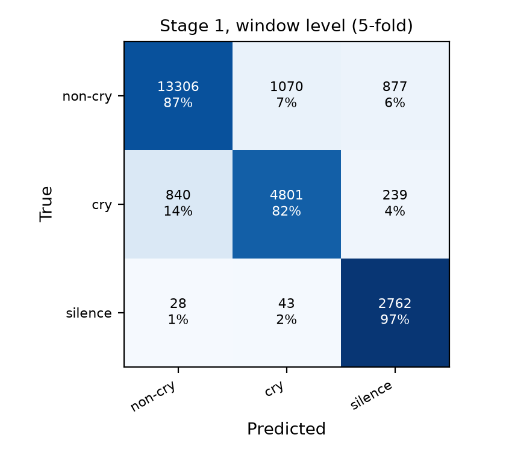
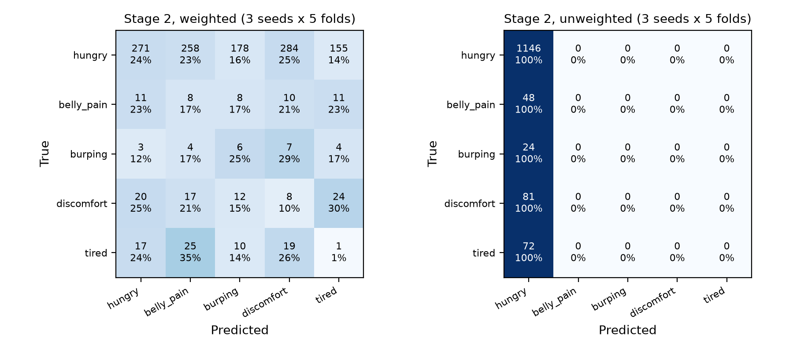
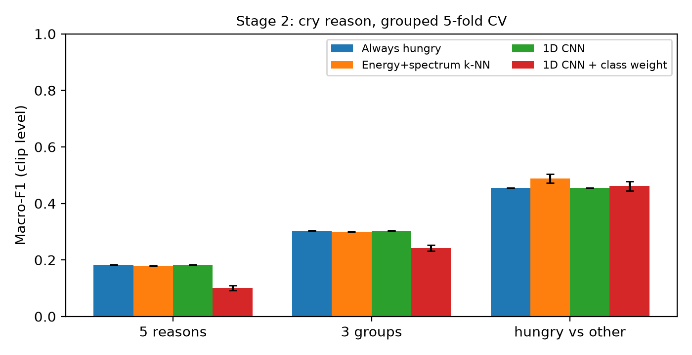

# Dokumentasi Proyek: Pengenalan Tangisan Bayi (*Infant Cry Recognition*)
**Smart Neonatal Incubator Sentinel — Eksperimen Offline & Ekspor Model Edge AI (E3)**

---

## 1. Gambaran Umum Proyek

Proyek ini mengimplementasikan sistem pengenalan suara tangisan bayi berbasis **TinyML / Edge AI** dua tahap (*two-stage infant cry recognition*) yang dirancang untuk perangkat mikrokontroler pada inkubator neonatal pintar (*Smart Neonatal Incubator Sentinel*):

1. **Stage 1 (Deteksi Tangisan / *Cry Detection*):** Membedakan apakah suara di dalam/sekitar inkubator merupakan **tangisan bayi (`cry`)**, **suara bising lingkungan (`non-cry`)**, atau **hening (`silence`)**.
2. **Stage 2 (Klasifikasi Alasan Tangisan / *Cry Reason Classification*):** Menguji apakah penyebab tangisan yang dilaporkan orang tua (*hungry, belly_pain, burping, discomfort, tired*) dapat dibedakan dari karakteristik akustik tangisan pada dataset publik.

Seluruh model dirancang dengan arsitektur **1D Convolutional Neural Network (1D-CNN)** yang sangat ringan dan dikuantisasi ke format **TensorFlow Lite Full-INT8** (~10 KB) agar dapat dijalankan langsung pada mikrokontroler seperti ESP32, STM32, atau Arduino Nano 33 BLE Sense menggunakan **TensorFlow Lite for Microcontrollers (TFLite Micro)**.

---

## 2. Struktur Berkas Proyek

```text
cry_recognition_code/
├── features.py                # Ekstraksi sinyal: resample 8 kHz, windowing 1 s (hop 0.5 s), 40-band log-mel
├── prep.py                    # Membangun dataset fitur window (data.npz) & metadata klip (data_clips.csv)
├── train_lib.py               # Arsitektur 1D-CNN, augmentasi SpecAugment, class weighting, kuantisasi INT8
├── baseline.py                # Model pembanding (Fahmi et al., 2020): statistik energi + spektral + k-NN (k=5)
├── stage1.py                  # Eksperimen 5-Fold Stratified Group CV untuk Stage 1 & uji lintas sumber
├── stage2.py                  # Eksperimen 5-Fold Stratified Group CV (3 seed) untuk Stage 2 (5/3/2 kelas)
├── plots.py                   # Pembuatan grafik confusion matrix & perbandingan Macro-F1
├── export_model.py            # Melatih model final Stage 1 pada seluruh data & mengekspor model ke folder models/
├── data.npz                   # [Output prep.py] Fitur log-mel seluruh window (23.966 window, ukuran 98x40)
├── data_clips.csv             # [Output prep.py] Daftar 2.457 klip audio beserta label dan grup sumber
├── stage1_results.json        # [Output stage1.py] Metrik lengkap hasil evaluasi Stage 1
├── stage1_predictions.csv     # [Output stage1.py] Skor probabilitas tangisan per klip
├── stage2_results.json        # [Output stage2.py] Metrik lengkap hasil evaluasi Stage 2
├── fig_stage1_confusion.png   # [Output plots.py] Confusion matrix Stage 1 (level window)
├── fig_stage2_confusion.png   # [Output plots.py] Confusion matrix Stage 2 (weighted vs unweighted)
├── fig_stage2_macro_f1.png    # [Output plots.py] Grafik batang perbandingan Macro-F1 Stage 2
└── models/                    # [Output export_model.py] Berkas model siap pakai / siap deploy
    ├── stage1_cry.keras       # Model Keras float32 standar (~64 KB)
    ├── stage1_cry_int8.tflite # Model TFLite Full-INT8 terkuantisasi (10,1 KB)
    ├── stage1_cry_model.h     # Array C/C++ dari model TFLite untuk TFLite Micro (ESP32/STM32/Arduino)
    └── stage1_norm.json       # Parameter normalisasi & kuantisasi input/output pada perangkat
```

---

## 3. Spesifikasi Pemrosesan Sinyal & Arsitektur Model

### 3.1. Pra-pemrosesan Audio & Ekstraksi Fitur (`features.py`)
Agar beban komputasi DSP di mikrokontroler tetap rendah, parameter sinyal ditetapkan sebagai berikut:
- **Sampling Rate (`SR`):** 8.000 Hz (Mono, `float32` dalam rentang `[-1, 1]`).
- **Windowing:** Durasi window **1,0 detik** (8.000 sampel) dengan pergeseran (*hop*) **0,5 detik** (4.000 sampel).
- **Ambang Hening (`SILENCE_DBFS`):** Window dengan energi RMS $< -50\text{ dBFS}$ dilabeli sebagai `silence` (kecuali jika seluruh klip berada di bawah $-50\text{ dBFS}$, maka label klip asli dipertahankan).
- **Log-Mel Spectrogram:**
  - Panjang frame STFT: **25 ms** (200 sampel) dengan Hann window.
  - Stride / hop antar frame: **10 ms** (80 sampel) $\rightarrow$ menghasilkan **98 frame waktu** per window 1 detik.
  - Ukuran FFT (`N_FFT`): **256** titik.
  - Jumlah filter Mel (`N_MELS`): **40 pita** (rentang frekuensi $20\text{ Hz} - 4.000\text{ Hz}$).
  - Skala logaritmik: $10 \log_{10}(\max(E, 10^{-10}))$ dengan batas bawah (*floor*) pada $-100\text{ dB}$.
  - **Dimensi Input Model:** `(98, 40)` per window 1 detik.

### 3.2. Arsitektur 1D-CNN (`train_lib.py`)
Model menggunakan konvolusi 1 dimensi yang bergerak sepanjang sumbu waktu (98 langkah waktu dengan 40 kanal pita Mel):

| Layer | Konfigurasi | Dimensi Output |
|---|---|---|
| **Input** | Log-Mel Spectrogram terstandarisasi | `(98, 40)` |
| **Conv1D_1** | 8 filter, kernel size = 3, padding = `same`, aktivasi = `ReLU` | `(98, 8)` |
| **MaxPooling1D_1** | Pool size = 2, padding = `same` | `(49, 8)` |
| **Dropout_1** | Rate = 0.25 | `(49, 8)` |
| **Conv1D_2** | 16 filter, kernel size = 3, padding = `same`, aktivasi = `ReLU` | `(49, 16)` |
| **MaxPooling1D_2** | Pool size = 2, padding = `same` | `(25, 16)` |
| **Dropout_2** | Rate = 0.25 | `(25, 16)` |
| **Flatten** | Meratakan tensor fitur | `(400,)` |
| **Dense (Output)** | `n_classes` unit (3 untuk Stage 1, 2/3/5 untuk Stage 2), aktivasi = `Softmax` | `(n_classes,)` |

**Teknik Pelatihan:**
- **Pencegahan Data Leakage (Grouping):** Pembagian *5-Fold Stratified Group Cross-Validation* mengelompokkan klip berdasarkan *App-Instance ID* (36 karakter pertama nama file) pada *Donate-a-Cry* dan `src_file` pada *ESC-50*. Rekaman dari bayi/ponsel/sumber yang sama tidak pernah berada di data latih dan data uji sekaligus.
- **Augmentasi Data (Hanya Data Latih):** Pergeseran gain acak ($\pm 0.3$ setelah normalisasi), *time masking* (maksimal 15 frame), *frequency masking* (maksimal 5 pita Mel), dan derau Gaussian ($\sigma = 0.05$).
- **Optimizer & Early Stopping:** Adam ($\text{lr} = 10^{-3}$), `sparse_categorical_crossentropy`, ukuran batch 128, *early stopping* (patience = 6 epoch) pada 10% *grouped validation split*.

---

## 4. Panduan Cara Menjalankan Eksperimen

### 4.1. Persiapan Lingkungan (*Virtual Environment*)
Dari terminal PowerShell di direktori proyek:

```powershell
# 1. Buat dan aktifkan virtual environment
& "C:\Users\lenov\AppData\Local\Programs\Python\Python313\python.exe" -m venv .venv
.\.venv\Scripts\Activate.ps1

# 2. Pasang dependensi
pip install tensorflow scikit-learn soundfile scipy pandas matplotlib
```

### 4.2. Unduh Dataset
Pastikan folder `donateacry-corpus` dan `ESC-50` tersedia di dalam direktori proyek:

```powershell
git clone --depth 1 https://github.com/gveres/donateacry-corpus.git
git clone --depth 1 https://github.com/karolpiczak/ESC-50.git
```

### 4.3. Eksekusi Pipeline
```powershell
# Langkah 1: Ekstraksi fitur log-mel ke data.npz (~1-3 menit)
python prep.py --dac donateacry-corpus --esc ESC-50 --out data.npz

# Langkah 2: Evaluasi 5-fold CV Stage 1 (~4 menit)
python stage1.py

# Langkah 3: Evaluasi 5-fold CV Stage 2 (~6-7 menit)
python stage2.py

# Langkah 4: Buat visualisasi grafik (.png)
python plots.py

# Langkah 5: Latih & ekspor model final siap deploy ke folder models/
python export_model.py
```

---

## 5. Hasil Eksperimen dan Analisis

### 5.1. Ringkasan Dataset (`prep.py`)
- **Total Klip Audio:** 2.457 klip
  - **Donate-a-Cry (`dac`):** 457 klip tangisan (`cry = 1`), terdiri atas: *hungry* (382), *discomfort* (27), *tired* (24), *belly_pain* (16), dan *burping* (8).
  - **ESC-50 (`esc`):** 2.000 klip suara lingkungan, terdiri atas 40 klip `crying_baby` (`cry = 1`) dan 1.960 klip non-tangisan dari 49 kategori lainnya (`cry = 0`).
- **Total Window (1 detik, hop 0,5 detik):** 23.966 window berukuran `(98, 40)`.
- **Window Hening ($< -50\text{ dBFS}$):** 3.007 window (12,5%).

---

### 5.2. Hasil Stage 1: Deteksi Tangisan (`stage1.py`)

#### Tabel Performa Level Klip (5-Fold Stratified Group CV)
| Metode Evaluasi | Akurasi | Macro-F1 | Presisi Tangis | Recall Tangis | Alarm Palsu (FPR Non-Cry) | Recall DAC | Recall ESC `crying_baby` |
|---|---|---|---|---|---|---|---|
| **1D-CNN (Mean $P \ge 0.5$)** | 92,59% | 0,8884 | 79,44% | 85,51% | 5,61% | 89,50% | 40,00% |
| **1D-CNN + Device Rule (3 window $\ge 0.80$)** | **93,98%** | **0,9019** | **90,30%** | 78,67% | **2,14%** | 81,62% | 45,00% |
| **1D-CNN INT8 TFLite (Mean $P \ge 0.5$)** | 92,59% | 0,8882 | 79,55% | 85,31% | 5,56% | 89,28% | 40,00% |
| **Baseline k-NN (Fahmi et al., 2020)** | 89,91% | 0,8472 | 73,53% | 78,27% | 7,14% | 80,74% | **50,00%** |
| **1D-CNN `dac_only` (Uji Lintas Sumber)** | 92,02% | 0,8823 | 76,64% | 87,12% | 6,73% | 91,90% | 32,50% |

#### Confusion Matrix Level Window (3 Kelas, Macro-F1 = 0,8472)
| Kelas Asli \ Prediksi | `non-cry` | `cry` | `silence` | Total Window | Recall per Kelas |
|---|---|---|---|---|---|
| **`non-cry`** | **13.306** | 1.070 | 877 | 15.253 | **87,2%** |
| **`cry`** | 840 | **4.801** | 239 | 5.880 | **81,6%** |
| **`silence`** | 28 | 43 | **2.762** | 2.833 | **97,5%** |



#### Temuan Penting Stage 1:
1. **Sangat Efisien untuk Perangkat Embedded:** Model TFLite INT8 hanya berukuran **10,1 KB – 10,3 KB** dan mempertahankan akurasi yang identik dengan model float32 (**92,59%**).
2. **Efektivitas *Device Rule*:** Menerapkan syarat pemicu alarm berupa *3 window berturut-turut (total durasi 2 detik) dengan rata-rata $P(\text{cry}) \ge 0.80$* berhasil menekan tingkat alarm palsu (*False Positive Rate*) dari **5,61% menjadi hanya 2,14%** dan meningkatkan presisi hingga **90,30%**.
3. **Analisis Alarm Palsu:** Kategori suara lingkungan ESC-50 yang paling sering memicu alarm palsu adalah suara bernada tinggi atau berpola harmonik berulang: `sheep` (20%), `church_bells` (17,5%), `insects` (15%), dan `hen` (15%).
4. **Evaluasi *Shortcut Learning* (`dac_only`):** Ketika 40 klip `crying_baby` dari ESC-50 dihapus dari pelatihan, model yang hanya dilatih pada Donate-a-Cry hanya mengenali **32,5%** tangisan bayi di ESC-50 (naik menjadi 40–45% bila diikutkan dalam pelatihan). Hal ini menunjukkan adanya *domain shift* antara rekaman ponsel jarak dekat (Donate-a-Cry) dan rekaman bervariasi dari Freesound (ESC-50).

---

### 5.3. Hasil Stage 2: Klasifikasi Alasan Tangisan (`stage2.py`)

Evaluasi dijalankan pada 457 klip *Donate-a-Cry* dengan 3 skema label, membandingkan model dengan dan tanpa bobot kelas (*class weighting*) selama 3 seed $\times$ 5 fold:

#### Tabel Perbandingan Macro-F1 Level Klip (Rata-rata $\pm$ SD)
| Skema Klasifikasi | Naive (*Always Hungry*) | Baseline k-NN | 1D-CNN (Unweighted) | 1D-CNN (Class-Weighted) | 1D-CNN INT8 (Weighted) |
|---|---|---|---|---|---|
| **5 Alasan** (*hungry, belly_pain, burping, discomfort, tired*) | 0,1821 | $0,1799 \pm 0,0003$ | $0,1821 \pm 0,0000$ | $0,1011 \pm 0,0085$ | 0,1025 |
| **3 Kelompok** (*hungry, pain/discomfort, tired/burping*) | 0,3035 | $0,3003 \pm 0,0014$ | $0,3035 \pm 0,0000$ | $0,2422 \pm 0,0105$ | — |
| **Biner (2 Kelas)** (*hungry vs other*) | 0,4553 | **$0,4885 \pm 0,0153$** | $0,4553 \pm 0,0000$ | $0,4617 \pm 0,0164$ | — |





#### Temuan Penting Stage 2:
1. **Kolaps ke Kelas Mayoritas pada Model Unweighted:** Karena 83,6% sampel adalah `hungry` (382 dari 457 klip), model 1D-CNN tanpa bobot kelas selalu memprediksi `hungry` untuk seluruh klip uji (recall `hungry` = 100%, recall kelas lain = 0%).
2. **Pemberian Bobot Kelas Tidak Mencukupi:** Saat diberikan bobot $w_c = N / (K \cdot n_c)$, model mulai memprediksi kelas minoritas namun dengan presisi sangat rendah (1–3% per kelas minoritas pada skema 5 kelas), sehingga *balanced accuracy* hanya mencapai **15,3%** (di bawah tebakan acak 20%).
3. **Rekomendasi Desain Sistem:** Pada perangkat inkubator pintar, **Stage 1 siap digunakan sebagai pendeteksi tangisan utama**, sedangkan klasifikasi penyebab tangisan (Stage 2) sebaiknya dipadukan dengan sensor multimodal (seperti suhu inkubator, kelembapan/sensor basah popok, dan jadwal pemberian ASI) daripada hanya mengandalkan spektrum suara dari dataset *Donate-a-Cry*.

---

## 6. Panduan Integrasi Model ke Perangkat Mikrokontroler (`models/`)

Berkas model final Stage 1 yang dihasilkan oleh `export_model.py` berada di folder `models/`. Untuk menanamkan model ke mikrokontroler (C/C++ dengan **TFLite Micro**):

1. **Salin Header Model:** Masukkan berkas [`models/stage1_cry_model.h`](models/stage1_cry_model.h) ke dalam proyek firmware Anda (`g_stage1_cry_model`, ukuran `10.376 bytes`).
2. **Parameter Pra-pemrosesan & Kuantisasi Input (`models/stage1_norm.json`):**
   Setiap window audio 1 detik (8.000 sampel pada 8 kHz) diubah menjadi matriks Log-Mel `(98, 40)` dalam satuan dB, lalu dikuantisasi ke `int8` menggunakan rumus berikut sebelum dimasukkan ke tensor input TFLite:
   ```c
   // Parameter dari models/stage1_norm.json
   const float FLOOR_DB    = -100.0f;
   const float NORM_MEAN   = -26.165323f;
   const float NORM_STD    = 28.830183f;
   const float INPUT_SCALE = 0.01849063f;
   const int   INPUT_ZP    = 11;

   // Konversi setiap elemen logmel[t][m] ke int8_t:
   float val = logmel[t][m] < FLOOR_DB ? FLOOR_DB : logmel[t][m];
   float norm = (val - NORM_MEAN) / NORM_STD;
   int32_t q = (int32_t)roundf(norm / INPUT_SCALE) + INPUT_ZP;
   if (q < -128) q = -128;
   if (q >  127) q =  127;
   input_tensor->data.int8[t * 40 + m] = (int8_t)q;
   ```
3. **Membaca Probabilitas Output & Aturan Alarm (*Device Rule*):**
   Tensor output memiliki 3 nilai `int8` (`[0] = non-cry`, `[1] = cry`, `[2] = silence`) dengan `output_scale = 0.00390625f` dan `output_zero_point = -128`:
   ```c
   float p_cry = (output_tensor->data.int8[1] - (-128)) * 0.00390625f;
   ```
   Simpan `p_cry` dari 3 window terakhir (pergeseran setiap 0,5 detik). Jika window tidak hening ($\text{RMS} \ge -50\text{ dBFS}$) dan rata-rata 3 window berturut-turut $\ge 0.80$, aktifkan notifikasi/alarm tangisan bayi.

